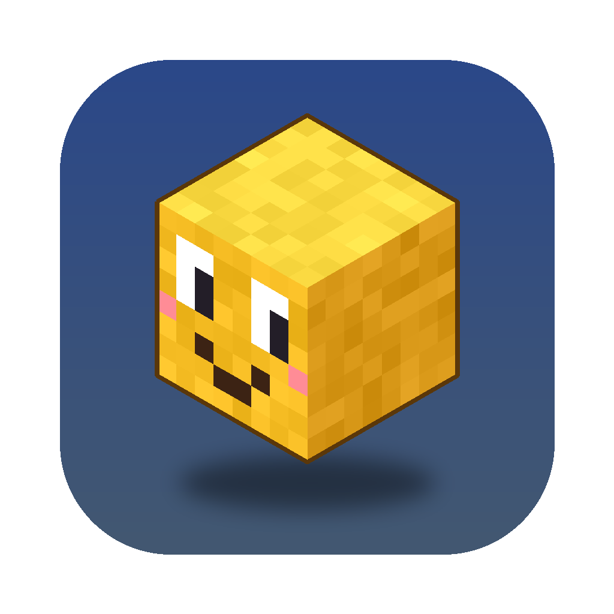

# Cubo

Um cubo de notificações para a secretária e a app **Cubo** para Mac, que junta num só sítio as notificações, as tarefas e a agenda.



## O que está aqui

| Pasta | O que é |
|---|---|
| `app/` | App **Cubo** para macOS (SwiftUI, vive na barra de menus) |
| `firmware/` | Firmware do cubo (ESP8266 + ecrã ST7789 240×240, GeekMagic SmallTV e clones) |
| `script-mac-antigo/` | Script Python original que enviava as notificações (substituído pela app) |
| `LEIA-ME-original.md` | Instruções originais de instalação do cubo |

## App Cubo

- **Hoje** — tarefas dos Lembretes e agenda do Calendário lado a lado.
- **Entrada** — notificações das apps escolhidas, com *Visto*, *Passar a tarefa* e *Abrir*.
- **Cubo** — estado, brilho, apps, redes Wi-Fi do cubo, pessoas prioritárias, atalhos.
- **Concentração** — silencia o cubo durante 30 min / 1 h / 2 h, exceto para pessoas escolhidas.
- **Mac em silêncio** — liga o Não incomodar do Mac sem calar o cubo (usa os atalhos em `app/Atalhos/`).
- Encontra o cubo sozinha em qualquer rede (`cubo.local` ou varrimento da rede local).
- Atalhos: ⌃⌥C abre a Cubo, ⌃⌥F liga/desliga a Concentração, ⌘1–3 separadores, E/T/O na Entrada.

**Compilar e instalar** (só precisa das Command Line Tools):

```bash
cd app && ./construir.sh
```

Instala em `~/Applications/Cubo.app`. Depois é preciso dar **Acesso Total ao Disco** à Cubo (para ler as notificações) e aceitar o acesso a Lembretes e Calendário. Sem o Xcode completo a macro `@State` não existe, por isso as vistas usam `Caixa` (um `ObservableObject`) com `@StateObject`.

A configuração fica em `~/Library/Application Support/Cubo/config.json`.

## Firmware

PlatformIO (`pip install platformio`; em Macs Apple Silicon precisa do Rosetta):

```bash
cd firmware && pio run -e cubo_4mb
```

Atualizar sem cabo:

```bash
curl -u admin:<token> -F firmware=@.pio/build/cubo_4mb/firmware.bin http://<ip-do-cubo>/update
```

Endpoints: `POST /notify`, `/limpar`, `/brilho`, `/resumo`, `GET|POST /redes`, `/redes/apagar`, `/token`, `/olhos`, `GET /estado`. Todos os POST pedem o cabeçalho `X-Token`.

**Código secreto:** o `CUBO_TOKEN` do `config.h` é só o valor de fábrica. Troca-o logo no portal `Cubo-Setup` ou com `POST /token` (`{"novo": "..."}`, 8–64 caracteres); fica guardado no cubo e tem de ser igual ao `token` do `config.json` da app.

**Ecrã do relógio:**
- 10 min antes de cada reunião, um anel em contagem decrescente (verde → laranja → vermelho a piscar no último minuto) e, quando começa, os olhos a sorrir.
- Durante a Concentração, um anel azul com o tempo que falta.
- Em baixo, quando não há notificações: o tempo lá fora (Open-Meteo, cidade escolhida na app) e o treino do dia e a forma, lidos da OkramX pela ligação MCP dela (`OkramX --mcp`).
- A app lembra uma pausa no cubo ao fim de 50 min seguidos ao computador.

No relógio, as horas alternam com uns olhos animados e coloridos (pré-visualização em `firmware/olhos-preview.gif`); `POST /olhos {"ativo":true,"cada":20}` liga/desliga e muda o intervalo, e `OLHOS_CADA_SEGUNDOS` no `config.h` define o valor de arranque.

**Pelo cabo USB:** ligado ao Mac por USB, o cubo funciona mesmo sem Wi-Fi. A app escreve na porta série (115200) uma linha `@/notify {json}` (ou `@/estado`, `@/resumo`, `@/hora {"epoch":…}`, …) e o cubo responde `@R <código> <json>`; pelo cabo não é preciso token e a app acerta-lhe a hora. Sem Wi-Fi o cubo já não reinicia: abre a rede `Cubo-Setup` e continua a aceitar pedidos pelo cabo.

O cubo guarda até 6 redes Wi-Fi e liga-se à conhecida com melhor sinal; se não encontrar nenhuma, cria a rede `Cubo-Setup`.
